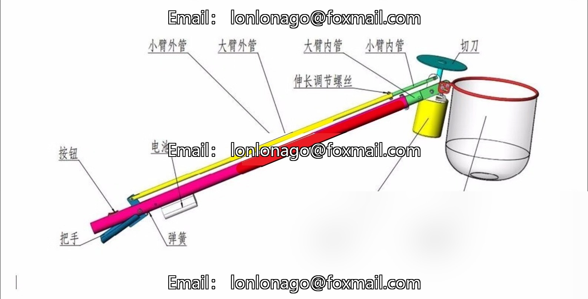
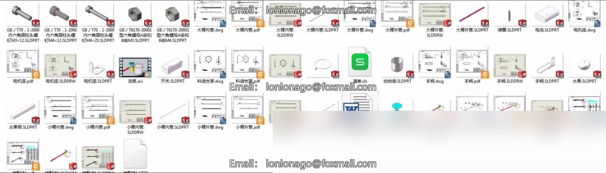

# Picking machine hand design picking machine hand design drawing electric picking machine hand three-dimensional drawing electric picking machine hand

## Body

Design of harvesting robotic hand, harvesting robotic hand design diagram, 3D diagram of electric harvesting robotic hand, harvesting robotic hand diagram
60. This design is a semi-automatic harvesting robotic hand, which contains a cutting motor, can be extended, and is driven by a mobile battery.

The design features a three-dimensional diagram of an electric picking hand, showing parts such as the small arm, large arm, spring, battery, motor housing and related drawings.

<!-- AI_ENRICHED -->

## Images

## Payment

Here is a pay link on Stripe ( https://buy.stripe.com/3cs8yP7sY87d0vu9AB ). Please contact me lonlonago@foxmail.com after funding $89, and I will send you a complete data files , thank you!

